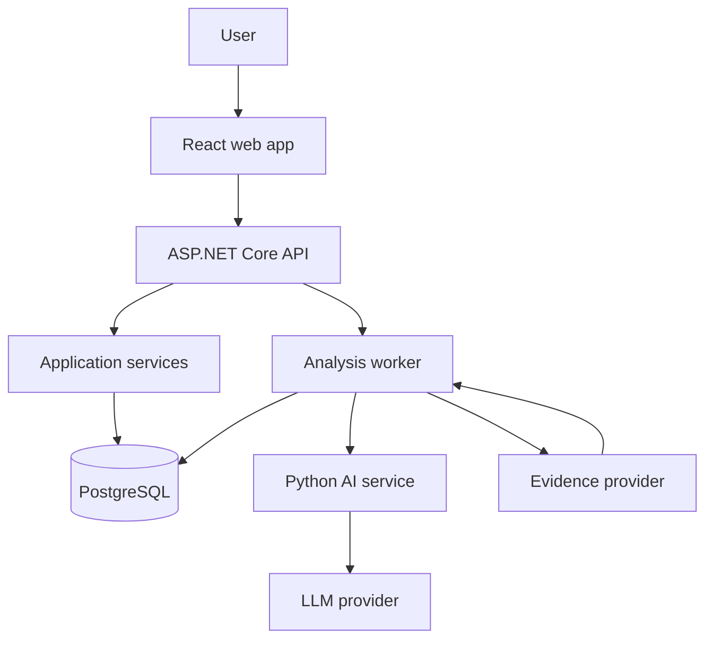

# ClaimLens

[](./.github/workflows/ci.yml)

**Investigate claims. Compare evidence. Understand the context.**

ClaimLens is an evidence-first investigation workspace. A user submits a claim or article text. The system extracts factual claims, collects evidence, classifies each piece as supporting, contradicting, or neutral, and calculates a **system confidence** verdict with the reasoning left visible.

The model does not decide whether something is true. A deterministic backend calculator does that from stored evidence. If the evidence is thin, the result is **Insufficient Evidence**. System confidence is not the probability that a claim is true.

## Status

| Area | State |
| --- | --- |
| Investigation pipeline | Extract, collect fixture evidence, classify, calculate a verdict |
| Review and admin | Reviewer queue and admin monitoring |
| Local Docker and CI | Compose file, GitHub Actions, Playwright path |
| Public demo | `docker-compose.prod.yml` |

## Run locally

Install the .NET 10 SDK, Node.js 22, and Python 3.12.

```bash
dotnet test apps/api/ClaimLens.slnx
dotnet run --project apps/api/src/ClaimLens.Api
```

```bash
cd apps/web
npm install
npm run dev
```

```bash
cd apps/ai-service
pip install -r requirements.txt
uvicorn app.main:app --reload --port 8000
```

Or start every service with Docker:

```bash
docker compose up --build
```

The web app is at `http://localhost:5173`, the API at `http://localhost:8080/api/health`, and the AI service at `http://localhost:8000/health`.

Development startup creates two local accounts. They are not created by the production compose file.

| Email | Password | Role |
| --- | --- | --- |
| `reviewer@claimlens.test` | `ChangeMe!Review1` | Reviewer |
| `admin@claimlens.test` | `ChangeMe!Admin1` | Admin |

The database password in the development compose file is `claimlens`. Do not reuse it on a public host.

## Public demo

The demo serves the site from one port. Postgres and the AI service are not published. With no model key, investigations finish on the mock model and fixture sources, and the page says so.

```bash
docker compose -p claimlens-demo --env-file demo.env.example -f docker-compose.prod.yml up --build
```

Open `http://localhost:8088`, register, and submit a claim. The project name `claimlens-demo` keeps this stack separate from the development containers.

For a public host, copy `demo.env.example` to a file that is not committed, replace `POSTGRES_PASSWORD`, `JWT_SECRET`, and `AI_SERVICE_KEY`, and set `PUBLIC_ORIGIN` to the https address visitors use. Terminate TLS in front of the web container. Then:

```bash
docker compose --env-file .env.production -f docker-compose.prod.yml up -d --build
```

Production startup applies database migrations. It does not create the reviewer or admin accounts.

## Documents

- [Requirements](docs/requirements.md)
- [Architecture](docs/architecture.md)
- [Database](docs/database.md)
- [API](docs/api.md)
- [Frontend](docs/frontend.md)
- [Roadmap and MVP](docs/roadmap.md)
- [Decisions worth changing](docs/decisions.md)
- [ADR 0001 — Deterministic verdict](docs/adr/0001-deterministic-verdict.md)
- [ADR 0002 — Processing status vs verdict](docs/adr/0002-processing-status-vs-verdict.md)
- [ADR 0003 — PostgreSQL-backed jobs](docs/adr/0003-postgres-backed-jobs.md)

## System



The browser never calls the AI service or an LLM. Evidence providers sit behind `IEvidenceProvider`. A mock provider is allowed in development and must be labeled as mock in stored records.

## Layout

```text
claimlens/
  apps/
    web/            React, TypeScript, Vite
    api/            ASP.NET Core solution
    ai-service/     FastAPI
  docs/
  infrastructure/
    docker/
  tests/
    e2e/
  .github/
    workflows/
```

## AI limitations

ClaimLens does not guarantee factual truth. Models misread text. Sources disagree and vary in quality. The confidence figure is **how strongly this system’s evidence set supports a classification**, not the probability that a claim is objectively true. Users should open the original sources.

The system must not invent evidence. No usable evidence means **Insufficient Evidence**.
