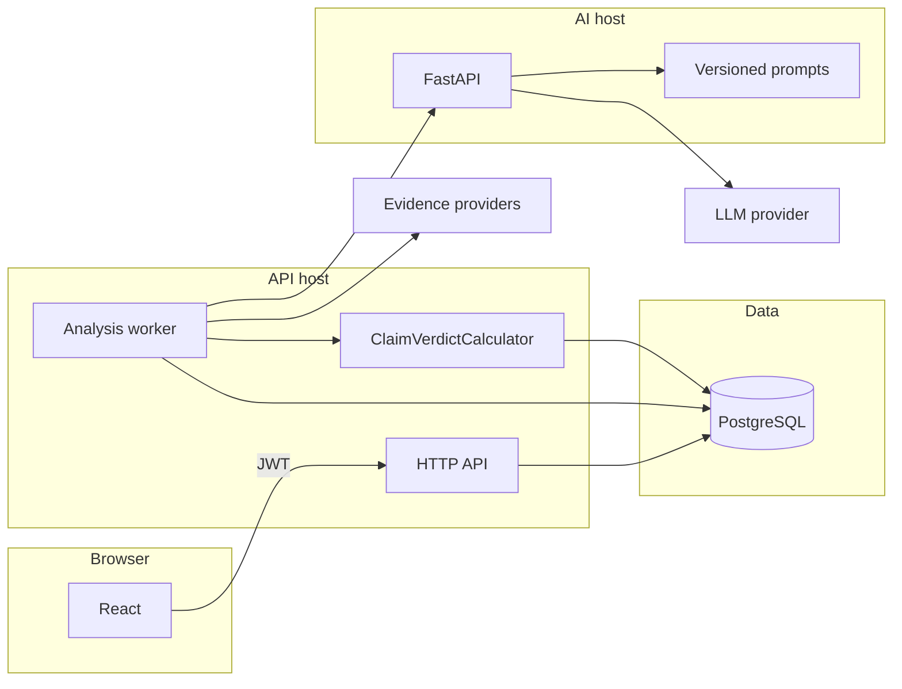
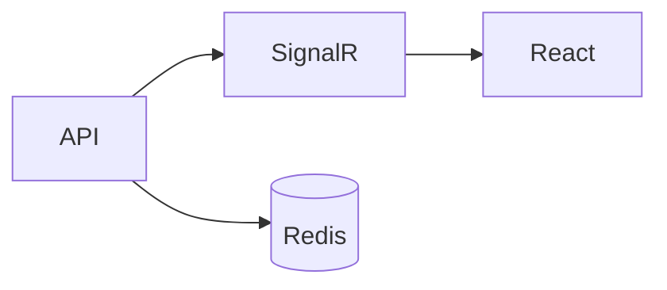
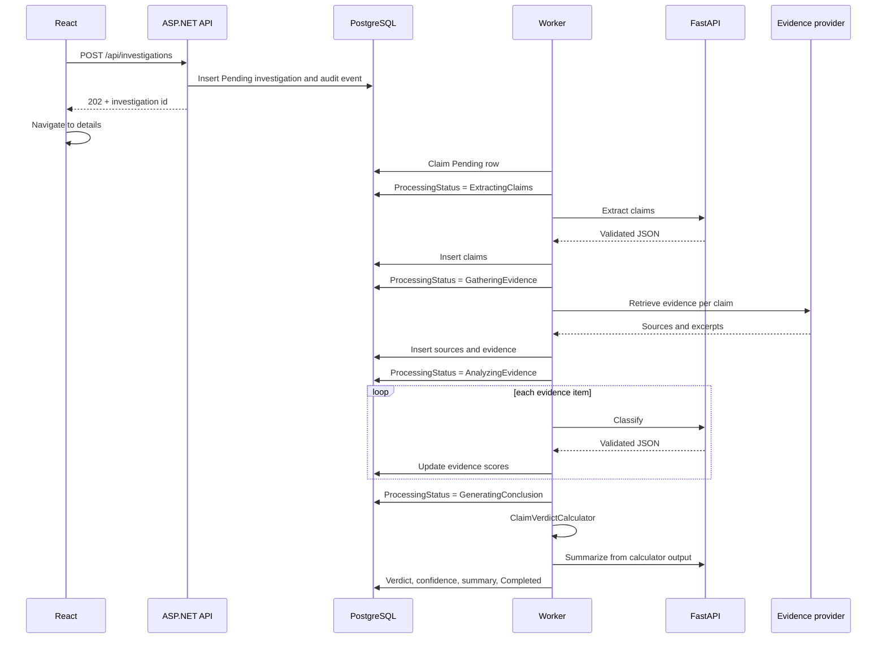

# Architecture

## Shape

Three deployable applications share one database owned by the .NET API.

| App | Responsibility |
| --- | --- |
| `apps/web` | UI, routing, server state via TanStack Query. No verdict math. |
| `apps/api` | Auth, persistence, validation, evidence orchestration, verdict calculation, authorization. |
| `apps/ai-service` | Prompt templates, LLM calls, JSON that matches a published schema. No database. |



Later additions, not part of MVP runtime:



Redis is added only when a single API instance is no longer enough for rate limits, cache, or locks.

## .NET layers

```text
apps/api/
  ClaimLens.sln
  src/
    ClaimLens.Domain/           entities, enums, verdict pure functions
    ClaimLens.Application/      use cases, DTOs, ports, validators
    ClaimLens.Infrastructure/   EF Core, JWT, evidence providers, AI client, worker
    ClaimLens.Api/              controllers, auth wiring, middleware
  tests/
    ClaimLens.Domain.Tests/
    ClaimLens.Application.Tests/
    ClaimLens.Api.IntegrationTests/
```

Controllers map HTTP to an application service and return DTOs. EF entities do not leave the API.

Application services are ordinary classes. MediatR is not used. The use-case count does not justify a mediator.

Domain holds the verdict calculator so it can be tested without ASP.NET or a database.

## Ports

| Port | Implemented in Infrastructure |
| --- | --- |
| `IInvestigationRepository` and related stores | EF Core |
| `IAiAnalysisClient` | HTTP client to FastAPI |
| `IEvidenceProvider` | `MockEvidenceProvider`, later `WebSearchEvidenceProvider` |
| `IPasswordHasher` | ASP.NET Core `PasswordHasher` |
| `ITokenService` | JWT access tokens, hashed refresh tokens |
| `IAnalysisQueue` | Rows in `investigations` claimed with `FOR UPDATE SKIP LOCKED` |

## AI service responsibilities

The Python service does only language work:

| Endpoint | Input | Output |
| --- | --- | --- |
| `POST /v1/claims/extract` | article or claim text, prompt version | claims: text, type, importance |
| `POST /v1/evidence/classify` | claim, evidence excerpt, source metadata | classification, relevance, confidence, explanation |
| `POST /v1/summaries/generate` | claim, verdict, evidence digests already computed by .NET | short explanation |
| `GET /health` | none | status |

It does not search the web, write to PostgreSQL, or choose the verdict. The .NET worker sends the smallest text needed for the task. It does not send passwords, tokens, or other users’ data.

Provider calls go through `LlmClient`. Development uses `MockLlmClient` when no API key is configured. Responses still pass the same Pydantic models the real provider must satisfy.

Prompt files live in `apps/ai-service/prompts/` and are named `claim-extraction-v1`, `evidence-classification-v1`, `summary-generation-v1`. Each AI call stores prompt name, prompt version, and model id on an `AiRun` row.

## Processing workflow

Creating an investigation is synchronous and short. Analysis is asynchronous.



Until the worker exists, Phase 4 only stores investigations. The UI shows `Pending` and does not pretend analysis ran.

Failed steps set `ProcessingStatus = Failed`, store an error code and a safe message, and write `analysis_failed`. The worker does not invent evidence to fill a gap.

Progress for MVP is polling `GET /api/investigations/{id}` about every two seconds while status is not terminal. SignalR replaces polling in a later phase without changing the status enum.

## Verdict calculation

Documented in [ADR 0001](adr/0001-deterministic-verdict.md). Summary:

- Drop evidence below the relevance and confidence floors.
- Require enough independent sources, or return `InsufficientEvidence`.
- Weight usable items by relevance, classification confidence, and an explainable source-quality multiplier.
- Map the support/contradict balance onto the six verdicts.
- Set system confidence from the margin and the number of independent sources.
- Roll an investigation up from its claims, weighted by importance. Strong disagreement between important claims yields `Mixed`.

## Folder structure

```text
claimlens/
  apps/
    web/
    api/
    ai-service/
  docs/
    adr/
  infrastructure/
    docker/
  tests/
    e2e/
  .github/
    workflows/
  .env.example
  .gitignore
  README.md
  docker-compose.yml          Phase 2
```

`apps/web`, `apps/api`, and `apps/ai-service` are the frontend and backend projects. They contain a README only until Phase 2 scaffolds the toolchains.

## Libraries

### Web

React 19, TypeScript, Vite, React Router, TanStack Query, Tailwind CSS, shadcn/ui (Radix primitives copied into the repo), react-hook-form, Zod, Vitest, Testing Library, Playwright in the E2E phase.

shadcn/ui is a component source, not a branded admin theme. Screens are composed for a research workspace.

### API

.NET 10, ASP.NET Core, EF Core, Npgsql, FluentValidation, Swashbuckle, `Microsoft.AspNetCore.Authentication.JwtBearer`, `PasswordHasher<T>` from Identity.Core without ASP.NET Identity user tables, Serilog.

Rate limiting uses the built-in ASP.NET limiter. No Redis package in MVP.

### AI service

Python 3.12, FastAPI, Pydantic v2, httpx, pytest, ruff. LLM access is an OpenAI-compatible client so the provider can change without a new architecture.

## Security outline

Details live in the API and roadmap docs. The rules that shape the design:

- Access tokens are short-lived. Refresh tokens are random, stored as hashes, rotated, and revoked on logout.
- Investigation queries always constrain by owner unless the caller is Admin or Reviewer.
- CORS allows the web origin only.
- Investigation create and auth endpoints are rate limited.
- Claim text is capped (about 2,000 characters). Article text is capped (about 50,000).
- Secrets come from environment variables. `.env.example` has placeholders only.
- The AI service accepts a shared internal key and is not reachable as a public product API.
- URL fetching, when added, must block private and link-local addresses.

## Error shape

```json
{
  "code": "INVESTIGATION_NOT_FOUND",
  "message": "Investigation could not be found."
}
```

Stack traces stay in logs. Logs include investigation id, user id, stage, duration, provider name, and error category. They omit passwords, tokens, and full article bodies.
